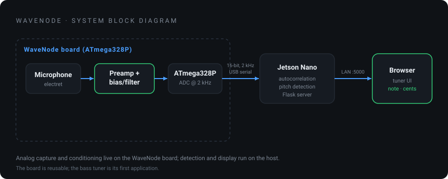
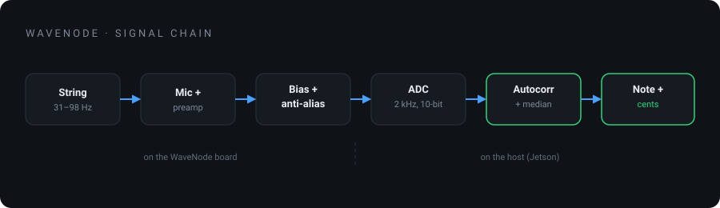
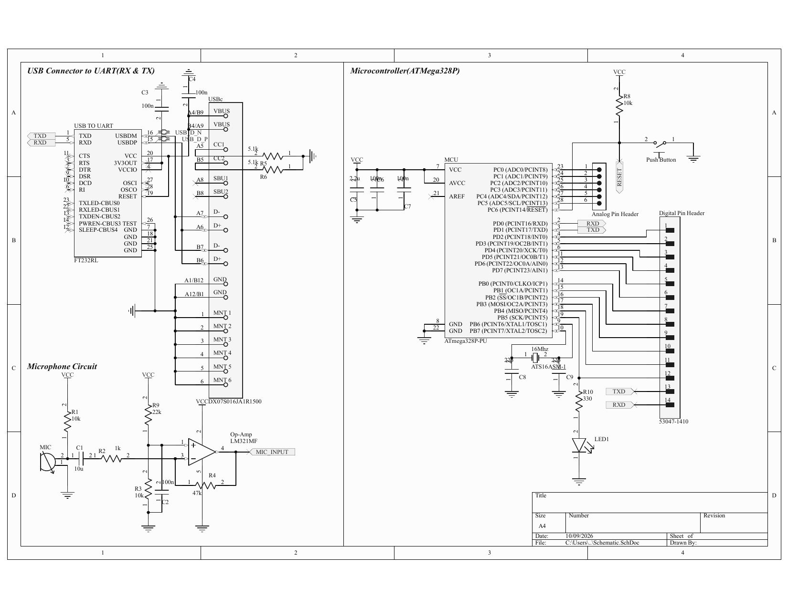
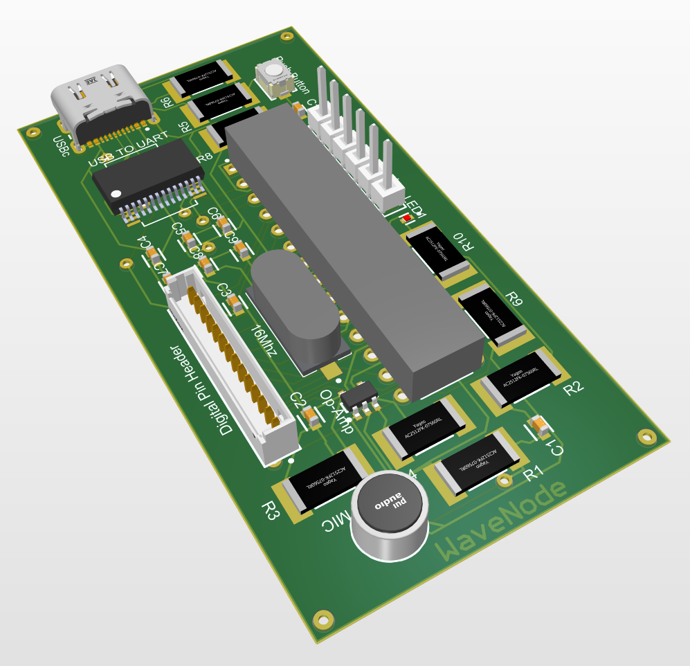
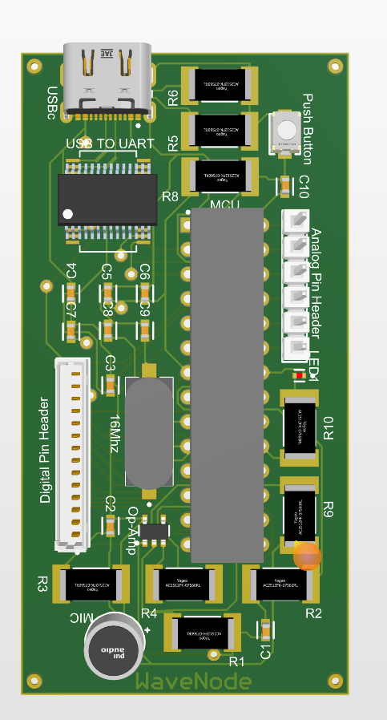
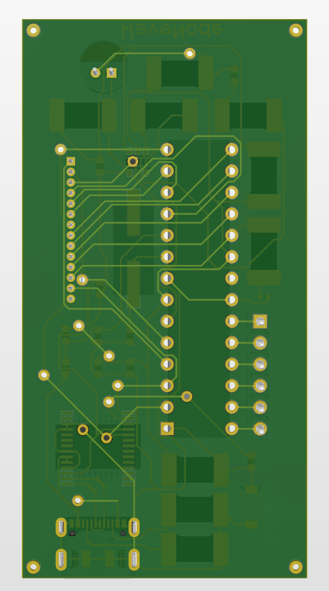
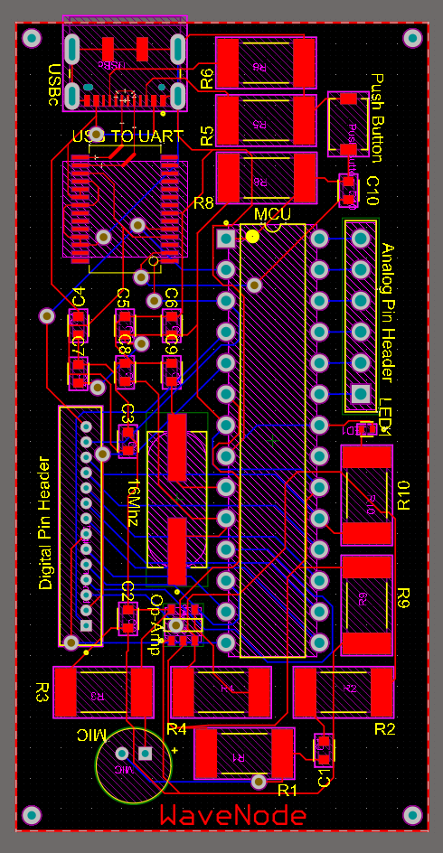

# WaveNode

WaveNode is a custom Arduino-compatible development board with an onboard
microphone front-end: an ATmega328P plus a mic preamp, biasing, and
anti-alias filtering wired into the ADC. It is meant to be reused across audio
projects. The first thing built on it is a real-time tuner for 5-string bass.



## The board and the demo

- **WaveNode (the board):** a reusable Arduino-compatible platform that captures
  and conditions an audio signal in hardware, so any project built on it starts
  with a clean signal into the ADC.
- **Bass tuner (the demo):** firmware + a host app that turn that signal into a
  live note readout. Pluck a string and a browser shows the note, cents sharp or
  flat, and lights up the matching string (B0, E1, A1, D2, G2).

## The tuner in action

&nbsp;&nbsp;

The web UI updates live: the note and octave, the frequency, a needle that swings
flat or sharp and turns green in tune, and the matched string lit on the ring.

## Signal chain



The analog capture and conditioning happen on the WaveNode board. Detection and
display run on a host (a Jetson Nano during development):

1. **Capture (WaveNode).** The mic feeds a preamp and bias/filter stage, then the
   ATmega328P samples it at a fixed 2 kHz and streams each 10-bit reading to the
   host as 2 raw bytes over USB serial at 115200 baud.
2. **Detection (host, Python).** The host reassembles the samples, removes the DC
   offset, and runs autocorrelation to find the pitch period. A median filter
   smooths the reading; the result converts to the nearest note and cents.
3. **Display (Flask web app).** A Flask server exposes the current note at
   `/pitch`; a single-page frontend polls it and drives the note readout, the
   cents needle, and the string ring, served on the local network.

## Running the tuner

On the host, with the board plugged in over USB:

```bash
pip3 install -r requirements.txt
python3 app.py
```

Then open `http://<host-ip>:5000` in a browser on the same network. The firmware
is in `firmware/`; flash it with the Arduino IDE. `SERIAL_PORT` in `app.py`
defaults to `/dev/ttyACM0`.

## WaveNode hardware

A custom Arduino-compatible board: an ATmega328P with USB-to-serial (FT232RL),
a 16 MHz clock, and an op-amp microphone preamp feeding the ADC. Designed in
Altium.

### Schematic



The four blocks: USB-C power and FT232RL USB-to-serial, the ATmega328P core with
crystal and reset, the Arduino-style pin headers, and the op-amp mic front-end
(electret bias, inverting preamp, bias network).

### PCB



&nbsp;&nbsp;



Source files are in `hardware/altium/` (`.PrjPcb`, `.SchDoc`, `.PcbDoc`); the
schematic PDF is in `hardware/`.

## Project layout

```
README.md                      this file
docs/                          block diagrams, schematic, board images
hardware/
  Bass Tuner Schematic.pdf     viewable schematic
  altium/                      Altium source: project, schematic, PCB
firmware/bass_tuner_nano.ino   samples the mic, streams over serial
app.py                         host backend: serial read, detection, API
index.html                     tuner frontend
requirements.txt               Python dependencies
```

## Design notes

- **Microphone front-end.** A bare electret into the ADC gives a weak signal for
  quiet low bass, so WaveNode puts a proper op-amp preamp with bias and filtering
  on the board, feeding a clean, centered signal into the ADC.
- **Sample rate and resolution.** Sampling at 2 kHz covers the bass range (B0 to
  G2) with headroom; parabolic interpolation on the autocorrelation peak refines
  the estimate at the lowest notes.
- **Detection.** Autocorrelation with a median filter over recent frames gives a
  stable reading, and a short hold keeps a decaying pluck from flickering.
